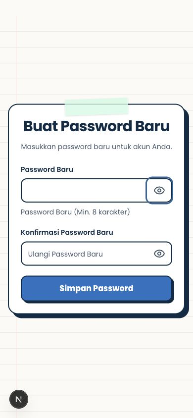
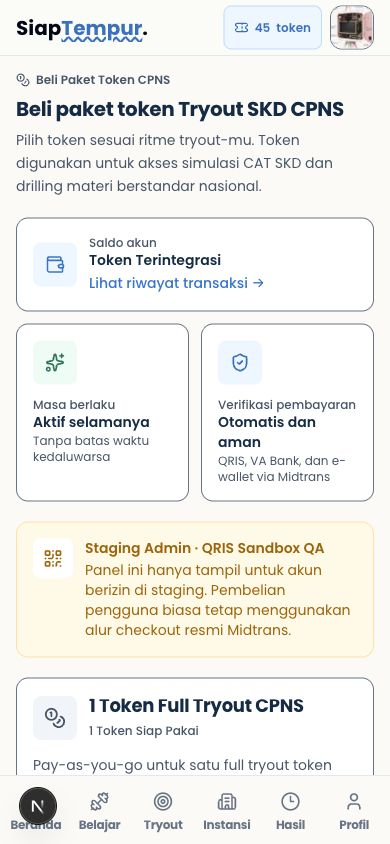
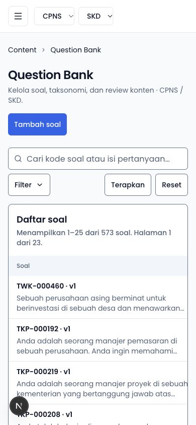

# Audit dan perapian UI SiapTempur

Audit: 11–12 Oktober 2026. Fokus: konsistensi, keterbacaan/kontras, dan penempatan UI sesuai tujuan halaman. Implementasi dilakukan dalam urutan tersebut.

## Ringkasan

Identitas SiapTempur sudah kuat: kanvas kertas hangat, biru dan ink, Poppins, serta aksen tulisan tangan dan bayangan tegas pada marketing. Masalah utama berasal dari token semantik yang belum lengkap, penggunaan warna foreground yang keliru, dan aturan CSS bersama yang menghapus latar gradient tanpa pengganti. Perapian memperjelas tombol, status, kartu, dan input; menampilkan semua tab profil di HP; serta menyederhanakan susunan form password dan informasi pendukung pembelian. Perubahan dibatasi pada presentasi, penempatan, dan atribut aksesibilitas terkait; handler, perhitungan, harga, isi soal, alur pembayaran, dan struktur data dipertahankan.

Pemeriksaan visual menggunakan Brave yang aktif. Halaman perwakilan diperiksa pada beberapa ukuran, bukan seluruh kemungkinan data dan state pada semua route. Hasil ini bukan klaim sertifikasi WCAG atau kelulusan seluruh alur aplikasi.

## 1. Acuan desain

Sumber acuan: `docs/DESIGN_SYSTEM.md`, `docs/UI_INTERACTION_STANDARDS.md`, `docs/PRODUCT_DESIGN_SYSTEM_V1_1.md`, dan token implementasi `app/globals.css`.

| Aspek | Acuan yang dipertahankan |
| --- | --- |
| Palet utama | Ink `#0D2B45`, biru `#1976D2`, amber `#F9A825`, peach `#FDDCCA`, kertas `#FBFAF7`, putih. Hijau/merah tetap digunakan untuk status semantik. |
| Tipografi | Poppins untuk UI, judul, dan isi; Patrick Hand untuk wordmark/aksen; mono yang sudah ada untuk kode/angka tertentu. Isi 14–16px, input HP 16px; metadata sekunder umumnya 12px. |
| Spacing | Skala 4/8/12/16/24/32/48/64/96px; padding kartu ringkas 20px diperbolehkan. Inset HP 16px, desktop 24–32px. |
| Radius | Token 12/16/20/24/32px; area belajar memakai 12–16px, admin mempertahankan kontrol/kartu 6–8px. |
| Bayangan | Marketing memakai outline ink dan hard shadow; learning memakai shadow lembut; ujian tenang; admin rapat dan fungsional. |
| Tombol/ikon | Varian utama, sekunder, outline, dan status mengikuti komponen bersama. Ikon mengikuti pustaka yang sudah digunakan. Aksi sentuh mandiri 44px; kepadatan aksi baris tabel admin tetap mengikuti kontrak khususnya. |
| Pembagian konteks | Marketing ekspresif; learning menonjolkan langkah belajar berikutnya; exam mengutamakan soal/navigasi; admin mengutamakan filter, tabel, dan form. |

Alias Tailwind gray/slate/blue/indigo/violet yang sudah dipetakan ke token brand tidak otomatis dianggap palet baru. Pemisah dekoratif dan garis tabel ringan tidak disamakan dengan batas kontrol interaktif.

## 2. Peta UI dan cakupan

Inventaris menemukan **86 file `app/**/page.tsx`**. Komponen bersama menjadi titik utama perbaikan agar konsumen terkait mendapat gaya yang sama.

| Kelompok | Halaman/komponen | Tujuan pengguna dan prioritas UI |
| --- | --- | --- |
| Publik/marketing | Home, CPNS, TKA, TWK/TIU/TKP, event, drilling, halaman ajakan bergabung | Memahami program dan menemukan CTA berikutnya. Aksen brand dipertahankan. |
| Auth/onboarding | Login, register, reset password, onboarding | Membaca label dan menyelesaikan form tanpa distraksi. |
| CPNS learning | Dashboard, tryout, mini tryout, drilling, event, leaderboard, profil | Mengetahui saldo/progres dan memilih latihan. |
| TKA learning | Jenjang, diagnostik, fokus, mini/full tryout, riwayat, soal salah, perkembangan, pilih jalur, profil | Menemukan latihan berikutnya dan membaca hasil/rekomendasi. |
| Exam/review | Sesi diagnostik/full exam/practice, konfirmasi bagian, hasil, pembahasan | Membaca soal, mengenali status jawaban, dan menavigasi pembahasan. |
| Commerce | Paket token, Tempur Pass, voucher, informasi pembayaran | Membandingkan akses/paket dan menemukan aksi pembelian. |
| Admin | Shell, kartu, filter/form, tabel, event, leaderboard, workspace konten | Menjalankan pekerjaan operasional dengan kepadatan konsisten. |
| Pendukung | Legal, blog, sertifikat, not-found/error | Membaca informasi serta memahami status/error. |

### Pemeriksaan melalui Brave

| Sampel | Ukuran/lebar dan hasil |
| --- | --- |
| `/cpns`, `/tka?landing=1` | 360/390/430/768/1024/1440px; tidak ditemukan overflow horizontal pada dokumen saat diperiksa. Identitas hero tetap dipertahankan. |
| `/tka/smp/tryout` | Pemeriksaan awal enam lebar di atas tidak menunjukkan overflow dokumen; latar CTA dipastikan kembali terlihat. Pengambilan ulang bukti desktop pada 12 Oktober terhalang error sesi, dijelaskan di bagian validasi. |
| `/auth/reset-password` | Enam lebar; helper password tidak lagi terpotong. Tombol mata 44×44px dan fokus keyboard terlihat pada pemeriksaan 390px. |
| `/cpns/dashboard/beli-paket` | Enam lebar; dokumen tidak meluber. Susunan informasi pendukung lebih ringkas di HP. |
| `/admin/content/questions` | Enam lebar; dokumen tidak meluber. Tabel tetap memiliki area scroll sendiri. Field HP 44px dengan font 16px. |
| Profil TKA | 360px; ketiga tab terlihat. Tab Pengaturan dibuka tanpa mengubah data akun. |
| Perkembangan TKA | 390px; backing warna pada elemen gradient diperiksa. Panel gelap diperkuat untuk keterbacaan. |
| Hasil dan pembahasan full tryout TKA | 390px; CTA pembahasan berwarna biru, radius kartu/tombol konsisten. Pembahasan terbuka dan lebar dokumen 390px. Tidak membuat atau mengirim jawaban baru. |

## 3. Temuan dan perbaikan

Jenis **1** = konsistensi; **2** = warna/kontras; **3** = kesesuaian konteks/penempatan. Nomor baris merujuk ke hasil implementasi pada saat laporan ini dibuat. Lokasi di tabel adalah titik utama dan contoh konsumen; perubahan token juga berlaku pada konsumen bersama lainnya.

| ID | Lokasi: file + baris/selector | Jenis | Kondisi sebelumnya | Perbaikan yang diterapkan |
| --- | --- | --- | --- | --- |
| 01 | `app/globals.css:342`, `:root` dan `@theme` | 1/2 | `bg-card`, `primary-muted`, serta beberapa status muted/border dipakai tanpa definisi root yang lengkap; permukaan dan ikon menjadi tidak konsisten. | Melengkapi token kartu, primary-muted/hover, input, disabled, dan status menggunakan palet yang ada. |
| 02 | `components/ui/Card.tsx:13`; `app/(legal)/layout.tsx`; halaman CPNS/error/sertifikat; `components/VoucherClaim.tsx` | 1 | Beberapa putih-kertas memakai hex berbeda yang sangat berdekatan. | Menggunakan `bg-background`, `bg-amber-50`, dan alias permukaan yang sudah tersedia sesuai konteks. |
| 03 | `components/tka/TkaLearning.module.css:1,69`; `components/dashboard/CompactLearning.module.css`; `components/profile/TkaProfile.module.css:50` | 1 | Radius 10/14px dan warna/bayangan literal menyimpang dari pola learning; beberapa kartu/tombol tanpa radius efektif pada shell TKA. | Menggunakan token radius 12/16px, surface, shadow, dan focus bersama; menghapus override warna tombol profil yang menimpa varian. |
| 04 | `app/globals.css:623`, `[data-experience-mode='learning'] [class*='bg-gradient-to-']` | 2 | Gradient dihapus oleh aturan learning tanpa warna latar pengganti. Teks putih/indikator dapat menghilang di atas permukaan terang. | Menambahkan fallback solid dari `--tw-gradient-from` sebelum `background-image: none`. Diverifikasi pada halaman learning. |
| 05 | `components/dashboard/DashboardShell.tsx:254`; `CommercePackagesClient.tsx:266,538`; `LeaderboardClient.tsx:147,328`; `components/practice/PracticeSessionParts.tsx:284` | 2 | `text-info-foreground` berarti putih, tetapi dipasang di atas info-muted/permukaan terang. Saldo, status, ikon, dan pemberitahuan sulit terlihat. | Mengganti pasangan tersebut menjadi `text-info` pada konsumen soft-info; token foreground putih tetap tersedia untuk permukaan solid. |
| 06 | `app/globals.css:353,355,386`; `components/ui/Button.tsx:24`; kartu learner/profil/Pass | 2 | Metadata ink-400/500 dan batas ink/slate-100/200/300 terlalu samar pada putih/kertas. | Muted text ink-600; batas kontrol/kartu netral menggunakan `input`/`border-strong` ink-500. Hover batas tetap kuat. Garis dekoratif ringan dipertahankan. |
| 07 | `app/globals.css:766`; `components/ui/Button.tsx:53`; `components/tka/TkaWrongQuestionModeClient.tsx:499,556` | 1/2 | Disabled bergantung pada opacity sehingga teks dan batas ikut memudar; sebagian hover memakai primary transparan. | State disabled memakai latar/teks/border netral yang eksplisit, tanpa shadow/transform. Hover primary memakai token warna lebih gelap. Kondisi disabled tidak berubah. |
| 08 | `components/admin/AdminUi.tsx:9,15,48`; `app/globals.css:1057,1110,1309` | 1/2 | Batas field/kartu admin tipis pucat; input HP tetap berukuran teks desktop; primary dark kurang kontras terhadap putih. | Batas memakai token input scoped admin, input HP 16px, primary dark lebih gelap. Kepadatan tabel dan perbedaan mode admin dipertahankan. Dark mode masih perlu verifikasi visual. |
| 09 | `components/practice/review/ReviewSidebar.tsx:64`; `components/tka/TkaFullExamSessionClient.tsx:633`; `TkaLearningFocusPanel.tsx:71` | 2 | Teks putih pada hijau-600 atau amber-500 kurang kontras; beberapa label state terlalu pucat. | Hijau status dengan teks putih memakai shade 700; angka/ikon di atas amber memakai ink gelap; status tetap disertai teks/ikon. |
| 10 | `components/tka/TkaProgressDashboard.tsx:242` | 2 | Panel berwarna dengan copy pucat/transparan memiliki margin keterbacaan yang rendah. | Backing biru lebih gelap, copy putih penuh, isi 14px. Tetap memakai keluarga warna brand yang ada. |
| 11 | `components/auth/ResetPasswordForm.tsx:58,78,97`; `app/auth/reset-password/page.tsx` | 1/3 | Kartu miring dan judul besar mendominasi form; label tersembunyi; placeholder panjang terpotong pada 360px. | Kartu tegak, hierarki lebih tenang, label terlihat, input 16px, tombol mata 44px. Teks placeholder lama dipindah utuh menjadi helper di bawah input; halaman memakai `min-h-dvh`. |
| 12 | `components/profile/ProfileClient.tsx:164` | 3 | Deretan tab horizontal menyebabkan Pengaturan tidak langsung terlihat pada 360px. | Grid tiga kolom di HP dengan ikon di atas label; desktop tetap mendatar. Border aktif menegaskan pilihan. |
| 13 | `components/dashboard/CommercePackagesClient.tsx:231` | 3 | Tiga kartu konteks bertumpuk penuh di HP, mendorong katalog lebih jauh ke bawah. | Saldo tetap penuh; masa berlaku dan verifikasi pembayaran berdampingan. Desktop tetap tiga kolom. Harga, urutan paket, dan panel QA yang ada tidak diubah. |
| 14 | `app/tka/[level]/tryout/[sessionId]/result/page.tsx:224` | 2/3 | CTA “Buka Pembahasan Soal” tidak memiliki penegasan primary yang efektif, sehingga menyatu dengan permukaan putih. | Permukaan biru primary, teks putih, hover lebih gelap, dan radius learning konsisten. Aksi remedial tetap sekunder. |

### Contoh perubahan fondasi

```css
/* Gradient learning tetap memiliki latar saat diratakan. */
[data-experience-mode='learning'] [class*='bg-gradient-to-'] {
  background-color: var(--tw-gradient-from, var(--px-surface));
  background-image: none;
}

/* Peran warna dapat digunakan ulang tanpa hex per komponen. */
:root {
  --card: var(--brand-white);
  --muted-foreground: var(--brand-ink-600);
  --input: var(--brand-ink-500);
  --px-border-strong: var(--brand-ink-500);
}
```

## 4. Pengukuran kontras

Angka berikut merupakan perhitungan pasangan warna solid dari token, dibulatkan dua desimal. Rasio tidak otomatis mencakup seluruh gambar, gradient, transparansi, atau state dinamis halaman.

| Pasangan yang diperbaiki | Sebelum | Sesudah |
| --- | --- | --- |
| Soft-info: putih → biru-600 di atas biru-50 | 1,09:1 | 4,54:1 |
| Metadata di atas putih: ink-400 → ink-600 | 2,62:1 | 7,55:1 |
| Label putih pada hijau: emerald-600 → emerald-700 | 3,67:1 | 5,37:1 |
| Batas kartu: ink-200/putih → ink-500/kertas | 1,23:1 | 4,56:1 |

Batas input admin `#64748b` terhadap kanvas `#f8fafc` sekitar 4,55:1. Hasil ini mendukung pilihan token untuk pasangan tersebut; semua kombinasi status/tema tetap membutuhkan pemeriksaan saat state terkait benar-benar muncul.

## 5. Sebelum → sesudah yang paling berdampak

1. **CTA learning:** latar gradient dapat hilang dan menyisakan teks putih → latar solid tetap ada, aksi utama terbaca.
2. **Hasil tryout:** link pembahasan terlihat seperti elemen putih biasa → tombol primary biru jelas menjadi langkah berikutnya.
3. **Form password:** label tersembunyi dan petunjuk terpotong → label permanen, petunjuk utuh, ikon mata mudah disentuh, fokus terlihat.
4. **Profil HP:** tab Pengaturan berada di luar area tampak → tiga tab tersedia langsung dalam satu baris grid.
5. **Paket token:** informasi pendukung memakan tiga baris kartu → saldo satu baris dan dua kartu pendukung berdampingan, sehingga katalog lebih dekat.

## 6. Validasi dan batasan

- **ESLint:** lolos untuk 65 file TSX pada daftar pemeriksaan UI.
- **Prettier:** lolos untuk 69 file TSX/CSS pada daftar pemeriksaan UI.
- **`git diff --check`:** lolos.
- **Typecheck:** belum lolos. Empat diagnostik TS2769 berada di `playwright.config.ts:63`, `:90`, `:113`, `:135`; nilai `browserName` pada susunan proyek kondisional melebar menjadi `string`. File tersebut sudah memiliki perubahan sebelum pekerjaan UI ini dan tidak diperbaiki dalam cakupan ini. Tidak ada diagnostik UI TSX yang dilaporkan pada run tersebut.
- **Pemuatan ulang terakhir tryout:** server menampilkan `PGRST303: JWT issued at future`; UI error boundary muncul. Pemeriksaan responsif tryout sebelumnya sempat berhasil, tetapi screenshot ulang desktop pada 12 Oktober tidak dapat dianggap berhasil. Penyebab sesi/waktu perlu verifikasi terpisah; konfigurasi auth tidak diubah.
- Tidak menjalankan pembelian, mengganti password, membuat sesi ujian baru, atau mengirim jawaban demi memunculkan state. Tidak menambahkan suite tes baru, tidak menjalankan build produksi, dan tidak melakukan deploy.
- Perubahan lain yang sudah ada di working tree, termasuk refactor workspace dan perubahan backend, bukan bagian dari klaim pekerjaan visual ini.
- `AGENTS.md` dan `CLAUDE.md` dibuat otomatis oleh versi Next.js saat dev server berjalan; tidak ditulis ulang sebagai bagian perapian UI.

## 7. Perlu verifikasi visual langsung di HP

1. **Safari iOS:** buka keyboard pada form reset, login, profil, dan filter admin. Pastikan tidak zoom otomatis, fokus tidak tertutup keyboard, dan form dapat digulir sampai aksi terakhir.
2. **Safe area:** periksa navigasi bawah, tombol tetap, dan footer ujian pada iPhone ber-notch/home indicator serta Android dengan navigasi gestur.
3. **Browser Android:** cek scroll tabel admin, dropdown/select native, modal panjang, dan wrapping label pada pengaturan font sistem lebih besar.
4. **State dinamis:** periksa loading/error/success/disabled pada sesi ujian dan pembayaran dengan data pengujian yang sesuai; tidak semua state dipaksa muncul dalam audit ini.
5. **Dark mode admin:** token telah diperbaiki berdasarkan kode/rasio, tetapi tampilan semua komponen dalam tema gelap belum diverifikasi langsung.
6. **Koneksi dan sesi:** ulangi pemuatan ruang tryout setelah masalah JWT selesai untuk memastikan verifikasi desktop terbaru bisa dituntaskan.

## 8. Hal yang sudah baik dan dipertahankan

- Palet hangat, wordmark, Poppins, maskot, sticker, dan hard shadow marketing sudah membentuk identitas yang konsisten.
- Pemisahan marketing, learning, exam, dan admin sudah tepat; admin tidak disamakan dengan halaman promosi.
- Struktur navigasi belajar, urutan isi soal, teks CTA, harga, serta alur domain dipertahankan.
- Scroll terpisah pada tabel admin dan layout soal yang mengutamakan keterbacaan dipertahankan.
- Warna status, aksen program, aset/logo pihak ketiga, dan palet konten soal/artikel tidak diganti secara massal.
- Latar fallback pada global error yang harus dapat berdiri sendiri tetap dipertahankan.

## 9. Bukti visual setelah perbaikan

Screenshot diambil dari Brave pada viewport 390×844px. Ikon Next.js di sudut layar adalah indikator server pengembangan.

### Form password dan fokus tombol mata



### Pembelian paket: informasi pendukung lebih ringkas



### Admin: filter dan tabel pada HP


